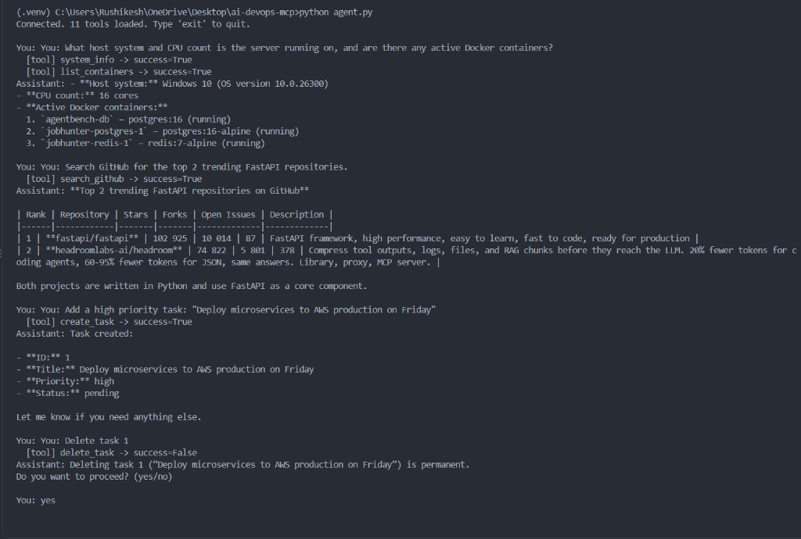

# AI DevOps MCP Server



An AI DevOps assistant built on the **Model Context Protocol (MCP)** with the **MCP Python SDK 2.x** (`MCPServer`, Streamable HTTP).
An LLM (Groq) discovers tools from the server at runtime and calls them through an MCP client.

```
User -> LLM (Groq) -> tool call -> MCP Client -> Streamable HTTP -> MCP Server -> Tool Registry
                                                                       |  auth -> permission -> validate -> run -> log
                                                                       +-- Calculator | GitHub | Tasks (SQL) | Docker | System
```



```mermaid
flowchart LR
    User["User / DevOps Engineer"] --> Agent["LLM Agent (Groq)"]
    Agent --> Client["MCP Client"]
    Client -- "Streamable HTTP (/mcp)" --> Server["MCP Server"]
    Server --> Gate["Security Gateway<br/>(Auth • RBAC • Redaction • HITL Confirmation)"]
    Gate --> Tools
    subgraph Tools ["Operations Suite"]
        direction TB
        Docker["Docker CLI (ps, logs, inspect, stats)"]
        GitHub["GitHub REST API (repos, issues)"]
        Tasks["PostgreSQL Task DB (SQLAlchemy & Alembic)"]
        Sys["Host Diagnostics (OS, CPU, Platform)"]
        Calc["Safe Calculator"]
    end
```

## Quick start (Windows PowerShell)

```powershell
python -m venv .venv
.venv\Scripts\activate
pip install -r requirements-dev.txt
copy .env.example .env        # then edit the API keys; add GROQ_API_KEY for the agent

python -m app.server          # terminal 1: server on http://127.0.0.1:8000/mcp
python client.py              # terminal 2: discovery + tool call (no LLM)
python agent.py               # terminal 2: chat with the LLM agent
pytest                        # run the tests
python evaluation.py          # tool-selection metrics (needs server + GROQ_API_KEY)
```

`MCP_API_KEY` in `.env` must match one key in `API_KEYS`. Local-only experiments: set `REQUIRE_AUTH=false`.

## Project layout

| Path | Role |
|---|---|
| `app/server.py` | Builds the `MCPServer`, wires auth, registers every tool module |
| `app/registry.py` | **The one door every tool goes through**: auth -> permission -> run -> structured errors -> logging |
| `app/tools/*.py` | Thin MCP tool functions (docstring = description the LLM reads) |
| `app/services/*.py` | Real logic: GitHub client, task rules + DB, Docker CLI. No MCP code |
| `app/models/task.py`, `app/database.py` | SQLAlchemy model + engine (`DATABASE_URL` picks SQLite or PostgreSQL) |
| `app/security/` | API-key verifier and READ / WRITE / DESTRUCTIVE permissions |
| `app/errors.py` | Error codes + `{"success": false, "error": {...}}` envelope |
| `app/observability.py` | One log line per tool call, secret redaction, in-memory metrics |
| `client.py`, `agent.py`, `evaluation.py` | MCP client, LLM agent loop, tool-selection evaluation |
| `alembic/` | Database migrations (use with PostgreSQL) |

## How the pieces work (interview notes)

**MCP.** A standard protocol so any LLM app can discover and call tools on any server. Server = exposes *tools* (actions), *resources* (readable data, e.g. `tasks://summary`) and *prompts* (templates, e.g. `triage_github_issues`). Client = connects, lists, calls. **Streamable HTTP** = one HTTP endpoint (`/mcp`) carrying JSON-RPC, with optional streaming; works behind load balancers, unlike stdio.

**Tool discovery.** `agent.py` calls `list_tools()`, then converts each MCP tool (name, docstring, JSON schema) to the LLM's function-calling format. Nothing is hardcoded: add a tool on the server and the agent sees it on next connect.

**Agent loop** (`Agent.chat`): send messages + tools to the LLM -> if it returns tool calls, execute each via MCP, append results as `tool` messages -> call the LLM again -> repeat until it answers in text (max 8 steps). Multiple tool calls in one turn, and chained calls across turns, are both handled.

**Confirmation (two layers).**
1. *Server:* `delete_task` without `confirm=true` deletes nothing and returns `CONFIRMATION_REQUIRED` with the task title. Needs the `destructive` permission as well.
2. *Agent:* tools marked `destructive_hint` (read from MCP annotations) pause for a **human y/N** before any `confirm=true` call is sent. The LLM cannot "confirm" for itself.

Why: LLMs can misread intent or be prompt-injected by data they read (e.g. a malicious GitHub issue). Irreversible actions need a check the model cannot bypass.

**Auth.** API keys sent as `Authorization: Bearer <key>`, verified by the SDK's `TokenVerifier` hook (constant-time compare). A bad key gets HTTP 401 before any tool runs. Each key carries scopes (`read`, `write`, `destructive`) that the registry enforces per tool. *JWT/OAuth:* the same hook, but `verify_token` validates a signed token (signature, expiry, audience) issued by an identity provider, and scopes come from token claims. Only `verify_token` changes.

**Errors.** Every tool returns `{"success": true, "data": ...}` or `{"success": false, "error": {"code", "message", "retryable"}}`.
- *User errors* (`INVALID_INPUT`, `CONFIRMATION_REQUIRED`): not retryable; fix the request.
- *Auth errors:* not retryable without different credentials.
- *Transient external failures* (`TIMEOUT`, `RATE_LIMITED`, GitHub 5xx): `retryable: true`. Timeouts/5xx are retried with backoff inside the GitHub service; rate limits are surfaced, not hammered.
- *Server errors* (`DATABASE_ERROR`, `UNKNOWN_ERROR`): logged with a traceback, generic message to the caller.

Malformed tool arguments (wrong type) and unknown tool names are rejected by the SDK itself as MCP-level errors (`is_error=True`).

**Observability.** Example log line: `TOOL=search_github USER=admin STATUS=SUCCESS LATENCY=342ms ARGS={...}`. Arguments named like `key/token/secret/password` are masked. Per-tool counters are readable via the `metrics://tools` resource.

## Docker / PostgreSQL

```powershell
copy .env.example .env      # set real passwords/keys first
docker compose up --build
```
Runs PostgreSQL (not published to the host) + the server, applying `alembic upgrade head` on start. Server on `http://localhost:8000/mcp`.
Docker tools (`list_containers`, `container_logs`, `inspect_container`, `container_stats`) need the Docker CLI and daemon access, so they work when you run the server directly on your machine, not in this container (mounting the Docker socket would give the container control of the host).

Migrations: `alembic upgrade head`. After changing the model: `alembic revision --autogenerate -m "message"`.

## Evaluation

`python evaluation.py` runs `eval_dataset.json` (24 queries, including no-tool, diagnostic, and destructive cases) and writes `eval_results.json` with tool selection accuracy, invalid tool-call rate, confirmation compliance, and execution success/latency for read-only tools:

| Model | Selection accuracy | Invalid-call rate | Confirmation compliance | Read Tool Avg Latency | Date |
|---|---|---|---|---|---|
| `openai/gpt-oss-20b` (Groq) | **100.0%** (24/24) | **0.0%** (0/22) | **100.0%** (2/2) | ~453ms | 2026-10-09 |

## Deployment

See `docs/AWS_DEPLOYMENT.md`. CI (`.github/workflows/ci.yml`) runs lint, tests, and a Docker build on every push.
